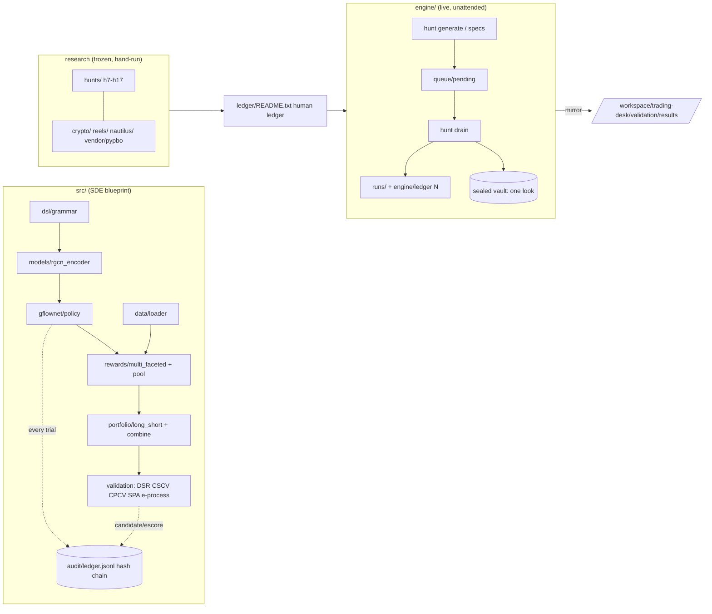

# strategy-hunter

Private research repo (owner: Aayan Shabbir). **Research only: it places no orders, holds no broker keys and never touches the live trading desk.**

It contains two independent systems that share one philosophy: every idea tried is counted (multiple-testing ledger), and anything that "passes" must survive deflation and out-of-sample checks before a human is even asked.

| system | what it is | where |
|---|---|---|
| **Strategy Hunter engine** | spec → pre-register (ledger N) → vectorbt backtest → pass bar (OOS, B&H, ≥100 trades, cost/stop ≤ 3%, walk-forward, random-entry twin + Holm, DSR, SPA, PBO) → one look at a sealed 12-month vault. Runs hourly/nightly unattended. | `engine/`, `ledger/` |
| **Strategy Discovery Engine (SDE)** | Blueprint implementation of an alpha-factor search: DSL grammar → RGCN encoder → GFlowNet policy → multi-faceted reward + factor pool → long-short portfolio → DSR / CSCV-PBO / CPCV / SPA / Ville e-process, all logged in a hash-chained trial ledger. | `src/`, `tests_sde/`, `runs_sde/` |
| **Hand-run research** | one-off hunts h7–h17, crypto batch, ORB reel test, NautilusTrader confirmation harness, vendored `pypbo`. | `hunts/`, `crypto/`, `reels/`, `nautilus/`, `vendor/` |

## Architecture

Details: [ARCHITECTURE.md](ARCHITECTURE.md). Doc index: [docs/README.md](docs/README.md).

## Quickstart (on the box)
```bash
cd /workspace/research_lab
# engine (research/paper only)
./engine/hunt status
./engine/hunt validate engine/specs/examples/example_donchian_filters.yaml
# SDE
PYTHONPATH=. .venv17/bin/python -m src.train.train_gfn --universe csi300 --episodes 10000 --seed 0 --run-id my_run
PYTHONPATH=. .venv17/bin/python -m src.train.evaluate_pool --run-id my_run
PYTHONPATH=. .venv17/bin/python -m src.train.phase3_eval  --run-id my_run
```
The interpreter is `.venv17/` (git-ignored; pinned versions in `requirements.lock.txt`). Market data keys, if any, come from the environment and are never stored.

## Tests
```bash
make test            # both suites
make test-sde        # PYTHONPATH=. pytest tests_sde      -> 73 tests, no market data needed
make test-engine     # cd engine && pytest                 -> 18 tests
make lint            # ruff correctness lint (src, tests_sde)
```
CI (`.github/workflows/ci.yml`) runs the SDE tests (CPU torch + numpy/pandas/scipy), ruff, a byte-compile of the engine and a forbidden-files check. The engine tests need the heavy vectorbt/numba/arch stack and stay a local `make test-engine` step.

## Data and secrets policy
Never committed: secrets/keys (`.env*`, `*.key`, `*.pem`), market data (`data/`, `*.parquet`, `*.csv`, `*.gz` except the ledger snapshot), the sealed vault data, model weights (`*.pt`), logs, virtualenvs and the live append-only SDE ledger (`src/audit/ledger.jsonl`, 50+ MB; a gzip snapshot `src/audit/ledger_<date>.jsonl.gz` is committed instead and is verifiable with `Ledger(path).verify()`). Convention for run folders: [docs/runs_sde.md](docs/runs_sde.md).

## SDE status (honest)
| phase | scope | state |
|---|---|---|
| 1 | DSL AST grammar + RGCN encoder | done |
| 2 | GFlowNet (TB + entropy), multi-faceted reward + factor pool, hash-chained ledger, Qlib/yfinance loader | done |
| 3 | long-short leverage-normalised portfolio with costs, pool combiner, DSR / CSCV-PBO / CPCV / SPA / Ville e-process, multi-universe runs | done for CSI300 and S&P 500 (seeds 0–2) plus a survivorship-reduced S&P 500 re-score. **CSI500 / CSI1000 were deliberately stopped partway at Aayan's request (not scored, no results, not a method failure; China is not tradable by the desk and the runs took hours). Focus is US stocks.** |
| 4 | trial ledger + e-process promotion gate | built (ledger in Phase 2, e-process in Phase 3); the blueprint's full Phase-4 definition is not on the box |

**Results vs blueprint targets (Sharpe ≥ 5.5, annual return ≥ 18%, PBO ≤ 10%): no run meets any target.** S&P 500 seeds 0/1/2 (survivorship-biased, test 2018–20, 5 bp): equal-weight Sharpe 1.10 / 0.91 / 0.86 (AR 9.8 / 7.4 / 7.8%), rolling-OLS 0.49 / 0.02 / 0.87; PBO 57 / 60 / 52%; DSR 0.000 for all; e-process max evidence ≤ 4.6 vs boundary 160. Re-scored on a survivorship-*reduced* point-in-time universe (extra check, 74.9% of member-days priced), equal-weight Sharpe falls to 0.24 / 0.18 / 0.16 and OLS to −0.06 / 0.08 / −0.35. CSI300 is ≈ 0 after 5 bp costs with PBO 74%. Full tables and open questions: [docs/sde_phase3.md](docs/sde_phase3.md).

## Credits
vectorbt, NautilusTrader, Optuna, numba, arch, pypbo (vendored), skfolio, quantstats, alpaca-py, PyTorch; methods by Bailey & López de Prado (PBO, DSR), Hansen (SPA), Holm, AlphaGen/AlphaSAGE, GFlowNets, R-GCN, Benhamou et al. 2026 (e-process). See [THIRD_PARTY_LICENSES.md](THIRD_PARTY_LICENSES.md). License: private, all rights reserved ([LICENSE](LICENSE)).
